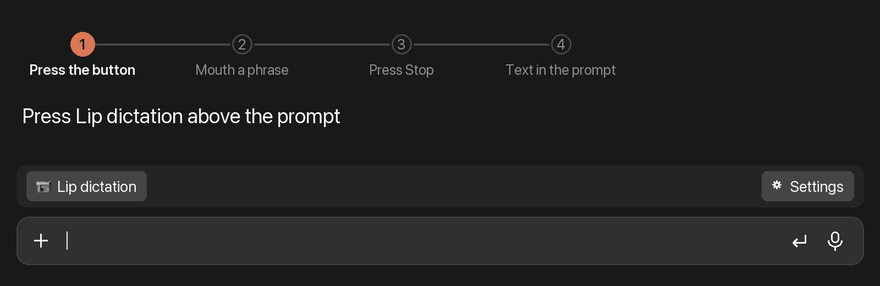
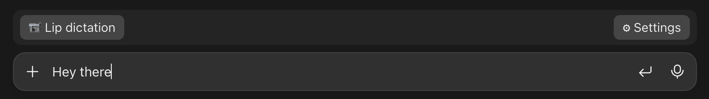
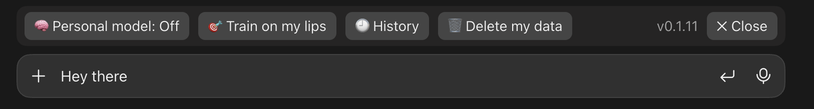

# lip-dictation

**Talk to Claude Code without making a sound.** Press a button above the prompt, mouth a phrase at your webcam, press again, and the words appear in the prompt box. A lip-reading model ([Auto-AVSR](https://github.com/mpc001/auto_avsr)) runs locally on your Mac: no audio is recorded and no video leaves your machine.



## Accuracy

**This is a prototype, and accuracy is modest.** Lip reading is hard, and silent mouthing is harder than speech: expect word errors, especially on technical terms, so read the text before you send it. Claude is told which words were lip-read (with the model's other readings), so it reads them in context and asks before acting on anything destructive.

Recognition uses Auto-AVSR's visual-only model [`vsr_trlrs2lrs3vox2avsp_base`](https://github.com/mpc001/auto_avsr#model-zoo): 250M parameters, trained on 3,291 hours of video (LRS2, LRS3, VoxCeleb2, AVSpeech). Accuracy is measured as word error rate (WER): wrong, missing and extra words divided by the words actually said, so lower is better.

| Setting | WER | Words right, roughly |
|---|---:|---:|
| This model on the LRS3 benchmark (TED talks, spoken aloud), as published by Auto-AVSR | **20.3%** | ~80% |
| For comparison: Auto-AVSR's audio models on the same benchmark | 1.0–2.0% | ~98–99% |
| Silent mouthing at a desk webcam, stock model, in the author's first tests | much higher | about half of short phrases right |

Why it is lower here than on the benchmark:

- **Silent mouthing moves the lips less** than speaking aloud, and the model learned from people speaking aloud.
- **A laptop webcam** at an angle, in office light, is harder than a TV camera on a well-lit face.
- **Vocabulary:** TED talks rarely say "refactor" or "pull request".
- **Speed over accuracy:** the plugin decodes with a beam of 10 and no external language model, to show the text about half a second after Stop.

What helps: short phrases, facing the camera in even light, mouthing a little more clearly than you would speak, and [training it on your lips](#train-it-on-your-lips). Training measures your own WER on held-out phrases before and after and keeps the personal model only when it is lower, and **⚙ Settings → 🕘 History** shows what the model read and what else it considered, so you can see your own accuracy.

## Why

Voice dictation needs you to speak out loud. Typing needs your hands and attention. Silent dictation fits the moments in between:

- **Open-plan office, coworking, café, library:** ask Claude to "run the tests" or "show me the diff" without talking over your neighbours.
- **On a call or in a meeting:** you are muted or listening, and can still send Claude a request.
- **At home when others are asleep:** late-night work without waking anyone.
- **Noisy places:** a train, a busy office. Lips don't care about background noise.
- **Privacy:** nobody nearby hears what you ask, and recognition never leaves your Mac.
- **Resting your hands or voice:** short commands without typing, or when speaking aloud is hard or tiring.

## Quick start

1. **Install the plugin.** In a terminal session of Claude Code:

   ```
   /plugin install lip-dictation --marketplace batanus/lip-dictation
   ```

   In the desktop app: click **+** next to the prompt box → **Plugins** → **Add marketplace** `batanus/lip-dictation` → **Add plugin**.

2. **Press 📹 Set up lip dictation** above the prompt (or run `/lip-setup`). It shows the download size and the model's license terms, and starts only when you press Install. Nothing needs to be installed first: setup fetches what is missing (Python, its packages, the model) into `~/.cache/lip-dictation`, about 1.5 GB, with a progress bar above the prompt. If your Mac lacks Apple's Command Line Tools, their installer opens; finish it and press Set up again.

3. **Press 📹 Lip dictation**, allow camera access when macOS asks (once), mouth a phrase, press **■ Stop**.

Requirements: macOS on Apple Silicon, a webcam, about 2.5 GB of disk, and Claude Code 2.1.287 or newer (terminal or desktop app).

## Use



1. Press **📹 Lip dictation** above the prompt. The camera turns on (the camera light shows it).
2. When the row shows **■ Stop ● 0:03 ▁▁▃▆█▅▂▁▁**, mouth one phrase clearly, facing the camera in good light. The timer counts up and the waveform follows your lips: bars rise when your mouth moves and settle to a flat line when it is still, and a warning if your face leaves the frame. Short phrases work best; recording stops by itself after 20 seconds, with a countdown for the last 5.
3. Press **■ Stop**. A "Reading lips" progress bar runs for a few seconds, then the text appears at the cursor. Nothing is sent until you press Enter.

The first dictation of a session takes about 2 seconds to turn the camera on, while Python and the model load. After it, the next dictation is loaded ahead and waits (about 1 GB of memory, for up to 10 minutes), so the camera starts as soon as you press. The model's encoder runs on the Mac's GPU, so the text appears about half a second after you press Stop.

In a terminal session, focus the button with ctrl+x then tab and press `l`, or bind a key to the `/lip` command in `~/.claude/keybindings.json`:

```json
{ "bindings": [{ "context": "Chat", "bindings": { "meta+l": "command:lip" } }] }
```

`meta+l` needs "Use Option as Meta key" turned on in Terminal.app or iTerm2; otherwise pick a combination that is free in your terminal. Typing `/lip` also works, but it replaces whatever is in the prompt box, so use the button or a key binding to add to a draft.

## Settings

**⚙ Settings**, at the right of the row, holds everything else:



- **🧠 Personal model: On / Off** — whether dictation uses the model trained on your lips (shown once you have trained one).
- **🎯 Train on my lips** — record phrases and train your personal model (below).
- **🕘 History** — what was read, what else the model considered, and what you sent.
- **🗑 Delete my data** — training recordings, personal model and history.
- The installed version, then **✕ Close**.

## Train it on your lips

**Why:** the stock model learned from people speaking aloud on TV and in talks. Silent mouthing moves the lips less, and everyone's lips move differently, so out of the box it makes more mistakes on you than on its benchmarks. Ten to fifteen minutes of your own phrases adapt it to you.

**How:** press **⚙ Settings → 🎯 Train on my lips** (or run `/lip-train`):

1. The row shows a phrase to mouth, such as «run the tests», with the usual **■ Stop** and waveform. Mouth it and press Stop. Only the mouth area (96×96 px) of each phrase is kept, in `~/.cache/lip-dictation/personal/`.
2. Press **● Next phrase** for the next one, as many as you like: **Train** appears after 20, and about 100 (10 to 15 minutes) works best. **Done** stops; the next `/lip-train` continues where you left off.
3. Press **Train**. A progress bar runs for a few minutes (about 1 second per phrase per pass, 8 passes). It adds small LoRA adapters (about 2M parameters) to the model's encoder, the part that reads the lips, and leaves the decoder, its language model, as it was, holds one phrase in five out, and measures the word error rate on those before and after. A toast reports both; the personal model replaces the stock one only when it makes fewer errors.

The phrases mix everyday English with short requests to a coding assistant, so the adapter learns your lips rather than one topic.

Once trained, **⚙ Settings** shows **🧠 Personal model: On**. Press it to switch to the stock model (**Off**) and back, for example to compare the two in the history; training a new model switches it on.

Each dictation also sends Claude the recognizer's other readings of the phrase (with the note below), since the right words are often among them.

## History

**⚙ Settings → 🕘 History** opens a pane with the last dictations, newest first: the text that was inserted, the other readings the model considered, the clip length, the time it took to read, whether your personal model was used, and whether you sent the text as read or edited it first (with the prompt you sent). It is the quickest way to see what the model gets wrong for you. The same data is in `~/.cache/lip-dictation/dictations.jsonl`, one JSON line per dictation or sent prompt, also printed by `scripts/lipread.sh --history`.

**⚙ Settings → 🗑 Delete my data** (or `scripts/lipread.sh forget`) deletes the training phrases, the personal model and the history.

The button is only shown on this computer's terminal and desktop app, never on remote surfaces such as the phone app, and `/lip` only starts the camera when typed here. Settings in `/config`: hide the button (the status line then shows the state) and turn the note to Claude off.

## How it works

```
button / /lip ──► mod (hooks/register.tsx) ──spawn──► scripts/lipread.sh ──► Lip Dictation.app ──► python -m lipread dictate
                    │   press: go file (standby) or a new process ──────────────► camera, resampled to 25 fps
                    │   2nd press writes a stop file                                (model loads meanwhile)
                    ◄── JSON lines: started / recording / level ×10/s / processing / result (+ other readings)
                          (level = lip opening from MediaPipe Face Mesh, drawn as the waveform)
  result: $.prompt.fill inserts at the cursor; on Enter a prompt.submit hook adds a note for Claude
  after it: the next dictation loads ahead (`dictate --wait`) and waits for the go file
```

- `sidecar/lipread/model.py`: mouth crops (MediaPipe) → Auto-AVSR encoder (on the GPU) → beam search, plus the personal adapter when it is on.
- `sidecar/lipread/personal.py`: the training phrases, LoRA training of the encoder and the word error rate check.
- `scripts/camera-app/`: the helper app macOS grants camera access to (see the comment in `main.c`).
- Each dictation is a line in `~/.cache/lip-dictation/dictations.jsonl`, the History pane's source.

## Privacy

- Camera permission is granted to a small "Lip Dictation" helper app that setup builds from `scripts/camera-app` into `~/.cache/lip-dictation`, not to your terminal or Claude. The sidecar runs through it because macOS refuses the camera without asking when the app running Claude Code declares no camera use, as under Claude Desktop.
- Dictation frames are kept in memory for the length of one recording and discarded; nothing is written to disk unless you pass `--save` to the command-line tool. Training phrases (`/lip-train`) are the exception: their mouth crops stay in `~/.cache/lip-dictation/personal/`. The history keeps the text of each dictation and of prompts that contained one in `~/.cache/lip-dictation/dictations.jsonl`. **⚙ Settings → 🗑 Delete my data** removes all of it.
- The only network access is the one-time setup: GitHub (uv, when it is not installed, and the Auto-AVSR code), PyPI (Python packages) and Google Drive (model weights).

## Contributing

Ideas, bug reports and pull requests are all welcome: share ideas and questions in [Discussions](https://github.com/batanus/lip-dictation/discussions), [open an issue](https://github.com/batanus/lip-dictation/issues/new/choose) (there is a template for sharing how well it reads your lips), or send a PR. Things that would help most:

- **Accuracy:** better training phrases, smarter training, a language model tuned for dictation, or a newer lip-reading model.
- **Other languages:** the model reads English only; a Russian or any other model would need new training data.
- **Platforms:** Intel Macs, Linux and Windows (the camera helper is the macOS-specific part).
- **Your results:** what works and what doesn't on your lips, camera and lighting. The History pane shows exactly what the model read.

Development: `claude plugin validate .` and `claude plugin test .` check the mod, and `scripts/lipread.sh check --camera` checks the Python side. [GUIDE.ru.md](GUIDE.ru.md) (in Russian) walks through running everything locally.

## Licenses

The code in this repository is MIT licensed. It does not include model code or weights:

- Auto-AVSR code is Apache-2.0; setup checks it out from the upstream repository at a pinned commit.
- The pretrained weights have **no explicit license** and were trained on LRS2/LRS3, VoxCeleb2 and AVSpeech, whose terms restrict use to research and non-commercial purposes. You download them yourself during setup and are responsible for following those terms.

## Uninstall

```
/plugin uninstall lip-dictation
rm -rf ~/.cache/lip-dictation
```
